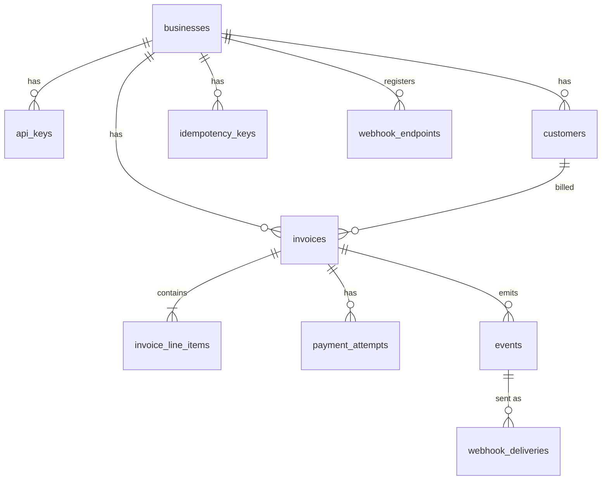

# Design

<!-- Aim for 800 to 1,500 words. Bullet points are fine. -->

## 1. Data Model



**General choices**

- **IDs are UUIDv7**, generated in the app. They sort by time, so they work as the pagination cursor and keep inserts cheap. They also can't be guessed. The payment attempt ID is also sent to the PSP as its idempotency key.
- **Money is `bigint` cents.** There are no floats anywhere. A `CHECK` makes sure each line's amount equals quantity × unit price.
- **States are `text` with a `CHECK`** instead of a Postgres enum, which makes them easier to change later.
- **Every table has `business_id`.** Invoices point to `(customer_id, business_id)`, so the database itself stops a business from billing another business's customer.

**Tables**

| Table | Indexes / constraints | Why |
|---|---|---|
| `api_keys` | unique `prefix` | We store only a SHA-256 hash of the key. The prefix is used to look it up. |
| `customers` | `(business_id, id DESC)`, unique `(business_id, lower(email))` | Fast listing per business. One customer per email. |
| `invoices` | `(business_id, state, id DESC)`, `(business_id, id DESC)`, partial on `locked_at` where `state = 'locked'` | Covers list with and without the state filter. The partial index lets the reconciler find stuck invoices quickly. |
| `invoice_line_items` | unique `(invoice_id, position)` | A real table, not JSON, so each line can be validated and the server computes the total. |
| `payment_attempts` | partial unique on `invoice_id` for `pending`, and again for `succeeded` | Even if the code has a bug, an invoice can't have two charges in flight or be paid twice. |
| `idempotency_keys` | PK `(business_id, key)` | Stores a hash of the request and the response, so a retry gets the same answer and a different body is rejected. |
| `events` | `(business_id, id)` | Written in the same transaction as the invoice change (outbox), so no event is ever lost. |
| `webhook_deliveries` | partial on `next_attempt_at` where `status = 'pending'` | The worker only looks at deliveries that are due. One row per event per endpoint. |

**At 100x scale**

- **Run more API instances.** The invoice lock is a conditional `UPDATE`, so Postgres already makes sure only one request wins. No extra coordination is needed.
- **Run the reconciler on one instance only**, or make it claim rows with `SKIP LOCKED` like the webhook worker does. Today every instance checks the same stuck invoices.
- **Partition the big, append-only tables by month** (`events`, `webhook_deliveries`, `payment_attempts`, `idempotency_keys`), so old data is cheap to drop.
- **Add read replicas** for list endpoints. If one database is still not enough, **shard by `business_id`**.

## 2. Invoice State Machine


**States**

- `open`: created and waiting for payment. Every new invoice starts here (there is no draft state).
- `locked`: a payment is in flight. Nothing else can touch the invoice until it finishes.
- `uncollectible`: the business has given up on collecting it, but it can still be paid or voided.
- `paid`: **terminal.**
- `void`: **terminal.**

**Transitions**

| From | To | Trigger |
|---|---|---|
| (new) | `open` | `POST /invoices` |
| `open`, `uncollectible` | `locked` | `POST /invoices/{id}/pay` |
| `locked` | `paid` | PSP says succeeded (from the pay handler or the reconciler) |
| `locked` | back to `open` / `uncollectible` | PSP declined, or the PSP has no record of the charge. The invoice returns to the state it was in before (`prev_state`). |
| `open` | `uncollectible` | `POST /invoices/{id}/mark_uncollectible` |
| `open`, `uncollectible` | `void` | `POST /invoices/{id}/void` |

If the PSP times out or the network fails, the invoice **stays `locked`**. The reconciler asks the PSP later for the real result and then moves it to `paid` or back to its previous state.

**Which transitions are reversible**

- `open → locked` and `uncollectible → locked` are undone automatically when a payment fails.
- `open → uncollectible` is one-way. You can't move it back to `open`, but you can still pay or void it, so nothing is lost.
- `paid` and `void` can never be left. Undoing a payment would need refunds, which are out of scope.

**How invalid transitions are rejected**

- The allowed "from" states for each action are defined in one place (`allowed_from` in `src/state_machine.rs`).
- The check and the write are a single SQL statement: `UPDATE invoices SET state = ... WHERE id = $1 AND state = ANY(allowed)`. If no row is updated, the move was not allowed. There is no gap between reading the state and writing it, so a concurrent request can't sneak in.
- When no row is updated, we load the current state and return **409** with a clear error code:
  - `invoice_already_paid`: pay on a paid invoice.
  - `payment_in_progress`: any action while the invoice is `locked`.
  - `invalid_state_transition`: anything else, e.g. void on a paid invoice.
- Moves out of `locked` are not public API actions. Only the pay handler and the reconciler make them, and always with `WHERE state = 'locked'`, so whichever gets there first wins and the other changes nothing.

## 3. Payment Correctness & Failure Modes

I use a status-conditional update. Paying starts with:

```sql
UPDATE invoices SET state = 'locked', prev_state = state, locked_at = now()
 WHERE id = $1 AND state IN ('open', 'uncollectible')
```

Only one request can match this row. Everyone else gets 0 rows back and is rejected. In the same transaction I insert a `pending` payment attempt, and I commit before calling the PSP.

I didn't use `SELECT ... FOR UPDATE` because it would hold a DB connection open for the whole PSP call (up to 1 s). Advisory locks disappear if the process crashes. With `locked` as a real state, the lock is visible in the table and survives a crash, so the reconciler can pick it up later.

### (a) Two concurrent POST /pay for the same invoice

One wins and charges the card. The other gets a `409` straight away (`payment_in_progress`, or `invoice_already_paid` if the first has already finished) and never reaches the PSP.

If the code ever got this wrong, the database still won't allow it: partial unique indexes on `payment_attempts` allow only one `pending` and one `succeeded` attempt per invoice.

`tests/concurrency.rs` fires 25 parallel payments and checks that exactly one succeeds and the PSP is charged once.

### (b) PSP times out (tok_timeout, 30 s)

My PSP client gives up after 1 s, so the endpoint never hangs. At that point I don't know if the card was charged, so I don't guess. The endpoint returns `202 Accepted` with the attempt still `pending`, and the invoice stays `locked`, so nobody can pay or void it in the meantime.

A background reconciler runs every 15 s and looks for invoices that have been locked for more than 60 s. For each one, it asks the PSP what happened to that attempt (the attempt ID is the PSP's idempotency key, so it can look it up). If the PSP says succeeded, the invoice becomes `paid`. If declined, it goes back to its previous state. If the PSP has no record of the charge, nothing was charged, so the invoice is released back to its previous state. If the PSP says it is still processing, the reconciler leaves it and checks again on the next run.

The caller can find out the result in three ways: the `invoice.paid` or `invoice.payment_failed` webhook, `GET /payment_attempts/{id}`, or retrying the same request with the same Idempotency-Key, which returns the current result.

`tests/psp_failure.rs` checks that the endpoint returns quickly, the invoice is locked in the meantime, and the reconciler later marks it `paid` with only one charge.

### (c) PSP succeeds but the service crashes before persisting

No, the customer is not charged twice.

Because I commit the lock and the `pending` attempt before calling the PSP, a crash at this point still leaves a record in the database: the invoice is `locked` and the attempt is `pending`. Nothing is lost, we just don't know the result yet.

On retry:
- **Same Idempotency-Key:** the key is already linked to that attempt, so we don't call the PSP again. It returns `202` with the attempt still `pending` until it is resolved.
- **New key:** the invoice is still `locked`, so it gets `409 payment_in_progress` and never reaches the PSP.

After the restart, the reconciler finds the invoice (locked for more than 60 s) and asks the PSP about that attempt. The PSP says succeeded, so the invoice is marked `paid` and the `invoice.paid` webhook goes out. This is the same path as a timeout in (b).

Even if the same attempt were somehow sent to the PSP again, the attempt ID is the PSP's idempotency key, so the PSP returns the original charge instead of making a new one.

### (d) Idempotency key reused with a different body

I reject it with `422 idempotency_key_reused` and don't call the PSP.

When a key is first used, I store a SHA-256 hash of the request (the invoice ID in the path plus the body) next to the key. On every later request with that key, I compare hashes. If they match, it's a real retry and I return the original result. If they don't, the client is using one key for two different things, and I'd rather fail loudly than guess which one they meant. Silently returning the old result would hide a bug on their side, for example a retry that switched to a different card.

Keys are scoped per business (`PRIMARY KEY (business_id, key)`), so two businesses using the same key never clash.

`tests/idempotency.rs` covers this: a declined payment followed by the same key with a different card gets a `422`, and the PSP is called only once.

### (e) POST /pay on a paid invoice

It depends on the key.

- **New key:** the conditional `UPDATE` only matches `open` or `uncollectible`, so it matches 0 rows. I return `409 invoice_already_paid` and the PSP is never called. I also save that `409` against the key, so retrying the same request returns the same answer.
- **Same key as the payment that succeeded:** this is just a retry, so I return the original `200` with the succeeded attempt. The client gets the answer it missed, without a second charge.

`paid` is terminal, so there is no path out of it. Getting money back would need refunds, which are out of scope.

`tests/idempotency.rs` checks that a second pay with a new key gets the `409`, the PSP is charged once, and retrying returns the identical `409`.

## 4. Webhook Design

**Signing.** Each endpoint gets its own secret (`whsec_...`) when it's registered. It is shown once. Every webhook carries a header:

```
Dodo-Signature: t=<unix seconds>,v1=<hex HMAC-SHA256>
```

The HMAC is computed over `"<t>.<raw body>"` with the endpoint secret. The receiver recomputes it, compares in constant time, and rejects anything with a timestamp older than about 5 minutes. Because the timestamp is part of what's signed, an attacker can't take an old webhook and replay it with a fresh time. I also send `Dodo-Event-Id`, so receivers can drop duplicates. Delivery is at-least-once, so a receiver might see the same event twice.

**Retries.** Any non-2xx response, timeout (10 s) or connection error counts as a failure. Retries back off like this: 30s, 2m, 10m, 30m, 1h, 3h, 6h, 12h, each with ±10% jitter so failing endpoints don't all get hit at the same moment. That's 9 attempts over about 23 hours.

**After the last retry**, the delivery is marked `dead` and I stop trying. Nothing is lost, though: the event is still in the `events` table. A business can see failed deliveries with `GET /webhook_deliveries?status=dead`, and catch up with `GET /events?after=<last event id they processed>`. Event IDs are time-ordered, so that returns everything they missed, in order.

**Decoupled from the API.** The API never sends webhooks itself. When an invoice changes, I insert the event and one delivery row per endpoint **in the same transaction** as the state change (an outbox). If the transaction rolls back, no webhook is ever sent for something that didn't happen. If it commits, the webhook is guaranteed to go out eventually. A background worker polls every second for due deliveries and claims them with `FOR UPDATE SKIP LOCKED`, so several instances can run it without sending the same delivery twice at once. A slow or broken receiver therefore never slows down `POST /pay`.

## 5. API Key Model

**Generation.** Keys look like `sk_live_` followed by 32 random alphanumeric characters (about 190 bits). The `sk_live_` part makes a leaked key easy to spot, for example by GitHub secret scanning.

**Storage.** I never store the key itself. I store the first 16 characters as a lookup prefix (not secret) and a SHA-256 hash of the full key. On each request I find the row by prefix, hash the key that was sent, and compare the two in constant time. I used SHA-256 rather than bcrypt because the key is long and random. There's nothing to brute-force like there is with a password, and a slow hash would just add latency to every request. If the database leaks, the attacker gets hashes they can't use.

**Transmission.** `Authorization: Bearer <key>`, over HTTPS only in production. The key is shown once when it's created and never again.

**Rotation.** A business can have several active keys at the same time. To rotate, create a new key, deploy it, then revoke the old one. There's no downtime.

**Revocation.** Set `revoked_at` on the key. The next request with it gets `401`. The row is kept for audit. To keep scope small, there are no API endpoints for creating or revoking keys yet. The schema supports both, but today it's done in the database.

**Blast radius.** A leaked key gives full access to one business: its customers, invoices, payments and webhook endpoints. It can't touch any other business, because every query is filtered by the `business_id` that comes from the key. It also can't steal card data, because we only hold PSP tokens. The worst realistic case is an attacker adding their own webhook URL to watch events, or voiding invoices. With more time I'd add scoped keys (e.g. read-only) and log every key's last use.

## 6. What I Cut and Why

1. **A `draft` state.** Real billing systems let you edit an invoice before sending it. Here invoices start as `open`, because a draft state means edit endpoints, rules for which fields can change, and more state machine paths, none of which help with the parts being tested (payments and failures). Adding it later is easy: one more state before `open`, plus a `finalize` action.

2. **Business sign-up and API key endpoints.** There's no way to sign up or to create, rotate or revoke keys over the API. A demo business and key are seeded on startup, and tests create their own. The schema already supports several keys per business and `revoked_at`, so the endpoints would be a thin layer on top.

3. **Re-sending dead webhooks.** After 9 failed attempts a delivery stays `dead`. I didn't add a "redeliver" button or endpoint. Businesses can still catch up with `GET /events?after=...`, which I think matters more. I also skipped webhook secret rotation for the same reason.

4. **Refunds and partial payments.** Out of scope for the assignment, and they would change the model a lot. An invoice would need an `amount_paid` and a `refunded` / `partially_refunded` state, and payment attempts would become a ledger of charges and refunds rather than "one success per invoice". I kept `paid` terminal so that this would be added as new states, not by weakening the existing ones.

## 7. Production Readiness Gap

1. **Metrics and alerts.** Right now I only have logs. The things that can quietly go wrong are invoices stuck in `locked`, webhooks piling up as `dead`, and the PSP timing out more than usual. I'd add metrics for each of them (count of invoices locked for more than 5 minutes, dead deliveries per hour, PSP latency and error rate) and page someone when they cross a threshold. I'd also add a request ID that follows a payment from the API call through the PSP call to the webhook, so one bad payment can be traced end to end.

2. **Rate limiting.** One business, or one leaked key, can currently send unlimited requests and use up the database connections for everyone. I'd add a per-key token bucket at the gateway or in Redis (for example 100 requests/s, with a lower limit on `POST /pay`), and return `429` with a `Retry-After` header.

3. **Security hardening around webhooks and secrets.**
   - Webhook secrets are stored in plaintext because we need them to sign. I'd encrypt them with a KMS key.
   - Webhook URLs are not checked, so a business could register `http://localhost` or an internal IP and make our server call our own internal services (SSRF). I'd allow only HTTPS, block private IP ranges, and send webhooks through an outbound proxy.
   - I'd also add an audit log of who voided an invoice, revoked a key or changed an endpoint, since that is the first thing anyone asks for after an incident.
