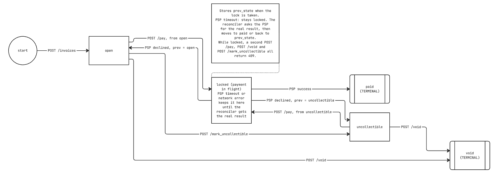

# Design

<!-- Aim for 800 to 1,500 words. Bullet points are fine. -->

## 1. Data Model

<!-- ER diagram or table listing. For each table: shape, indexes, primary key
strategy, why this shape over alternatives, and what you would change at 100x scale. -->

## 2. Invoice State Machine

<!-- All states, valid transitions, trigger for each, terminal states.
Then: which transitions are reversible, and how invalid transitions are rejected. -->

## 3. Payment Correctness & Failure Modes

<!-- Name your concurrency mechanism and explain why over the alternatives. -->

### (a) Two concurrent POST /pay for the same invoice

### (b) PSP times out (tok_timeout, 30 s)

### (c) PSP succeeds but the service crashes before persisting

### (d) Idempotency key reused with a different body

### (e) POST /pay on a paid invoice

## 4. Webhook Design

<!-- Signing scheme (algorithm, what is signed, replay protection). Retry policy
with specific numbers. What happens after the retry budget is exhausted. How a
business reconciles missed events. Why and how delivery is decoupled from the API. -->

## 5. API Key Model

<!-- Generation, storage, transmission, rotation, revocation, blast radius if leaked. -->

## 6. What I Cut and Why

<!-- 3 to 5 things you deliberately did not build. -->

## 7. Production Readiness Gap

<!-- Top 3 things missing if this shipped tomorrow. -->
